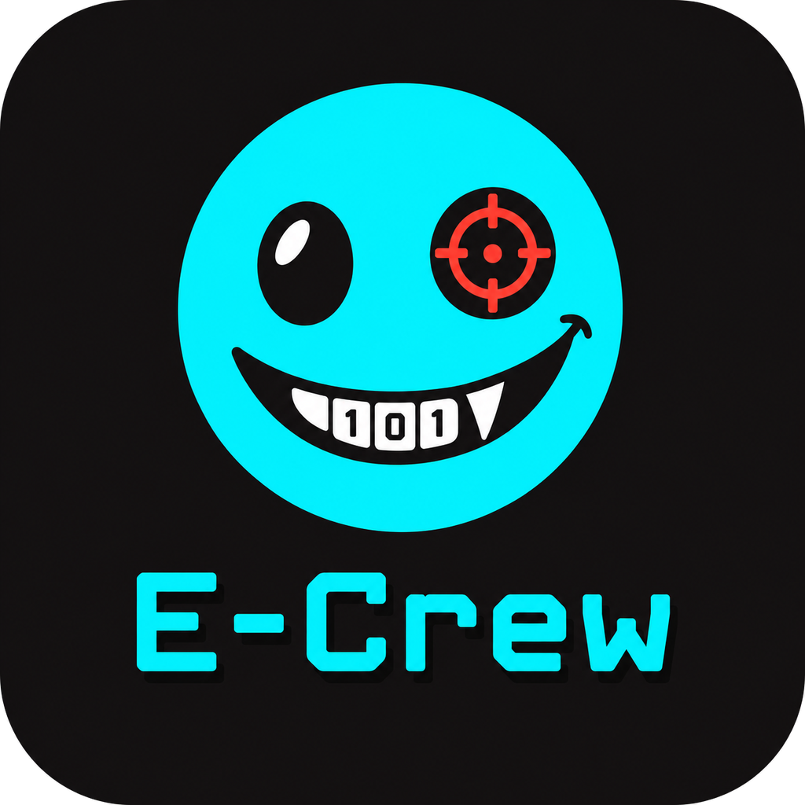

# E-Crew

<p align="center">
  
</p>

E-Crew is an offline-first Android toolkit for device security assessment, digital
forensics, local communications, and field operations. It is built with Kotlin,
Jetpack Compose, the Android NDK, and a vendored llama.cpp runtime for on-device
inference. Core workflows do not require a cloud service.

> **Authorized use only.** E-Crew contains security testing, network interception,
> acquisition, and remote-support capabilities. Use it only on devices you own or
> have explicit written authorization to assess. You are responsible for complying
> with all applicable laws, platform policies, and organizational rules.

## Capabilities

| Area | Description | Access |
| --- | --- | --- |
| Security Audit | 54 read-only device checks across base, ADB, Shizuku, and optional root tiers, with severity ranking, UNKNOWN-safe scoring, local history, and redacted exports. | ADB, Shizuku, or root grants are optional and never applied automatically. |
| APK Analysis | In-process AXML, ARSC, and DEX parsing; manifest, signing, secret, native-library, FileProvider, and Flutter signals; merge-and-rank findings; jadx 1.4.7 decompilation; picked or shared APK intake. | Static analysis needs no privilege. Dynamic fuzzing requires Shizuku plus a written-authorization attestation. |
| Acquisition | AndroidQF-compatible ZIP exports with `acquisition.json`, `hashes.csv`, and command logs; public and privileged read-only modules; optional user-APK copies; AES-256-GCM encrypted archives. | Public artifacts work without setup. Privileged modules require a one-time DUMP grant. |
| IoC Triage | Offline STIX 2 pattern matching for hashes, domains, IP addresses, and URLs against acquisition evidence. | No network access. |
| Network Interception | Loopback HTTP CONNECT proxy for operator-run upstream tools, redacted in-memory request log, foreground service, consent gate, and inert Frida guidance. | Explicit consent is required. Global-proxy changes require Shizuku. TLS is never intercepted or decrypted. |
| Remote Support | Consent-based remote agent over LAN or Bluetooth with session auditing and an in-app agent handoff. | The target device must install the agent and approve the session. |
| Peer Messaging | Local peer-to-peer chat over LAN or Bluetooth with PBKDF2-HMAC-SHA256 key derivation and AES-GCM framing. | No external message relay. |
| Field Utilities | QR and payload analysis, a real PTY terminal, Wi-Fi scanning and wardriving, LAN discovery, WPS inspection, and local PCAP capture. | Runtime permissions and, for packet capture, a local VPN consent prompt. |
| Xairex | On-device assistant powered by a bundled SmolLM2 360M instruct model through llama.cpp. | Fully local inference; no prompt or completion leaves the device. |
| GRIDSHOCK | An offline 8x8 endless block puzzle with deterministic piece generation, isolated storage, and synthesized audio. | No additional permissions. |

## Requirements

- Android 8.0 (API 26) or later.
- JDK 17.
- Android SDK Platform 34 and Build-Tools 34.0.0.
- Android NDK 26.3.11579264 and CMake 3.22.1.
- Git LFS, for the bundled model.
- Network access on the first build, to resolve Gradle and Maven dependencies.

The application targets API 28 to preserve the legacy storage and Bluetooth behavior
the toolkit was designed around. It is a sideloaded tool and is not intended for
Google Play distribution.

## Build

```bash
git clone https://github.com/Xenoz-GitHub/E-Crew.git
cd E-Crew
git lfs install
git lfs pull
./gradlew :app:assembleRelease
```

On Windows:

```powershell
.\gradlew.bat :app:assembleRelease
```

The APK is written to `app/build/outputs/apk/release/app-release.apk`. The debug
variant is available via `:app:assembleDebug`, and the standalone remote agent via
`:agent:assembleRelease`.

`local.properties` is generated by Android Studio or can be created manually:

```properties
sdk.dir=C\:\\path\\to\\Android\\Sdk
```

The release build is currently signed with the Android debug keystore so that the
APK can be installed for evaluation. Configure a private release signing key before
distributing builds.

## Repository Layout

| Module | Purpose |
| --- | --- |
| `app/` | Main Android application: UI, feature modules, local databases, and background services. |
| `agent/` | Consent-gated remote-support agent packaged into the controller as `ecrew-agent.apk`. |
| `shared-protocol/` | JVM library for the encrypted transport, handshake, framing, and inventory protocol. |
| `llm/` | Native library that builds llama.cpp and exposes the Xairex inference bridge. |
| `tools/` | Build and asset-verification helpers. |
| `docs/` | Project artwork and documentation assets. |

## Privacy and Security Model

- Local-first processing. There is no telemetry, analytics, or cloud inference path.
- Sensitive operations are gated by explicit consent and recorded in local audit logs.
- Keys, message content, proxy credentials, and model prompts are not written to logs.
- ADB, Shizuku, and root privileges are operator grants. E-Crew never auto-grants them.
- The interception proxy forwards TLS without terminating it. E-Crew bundles no
  certificate authority, Frida server, or privileged helper that the operator did
  not obtain independently.
- APK analysis is non-executing: candidate packages are parsed statically unless the
  operator explicitly runs the attestation-gated fuzzing workflow.

## Known Limitations

- Physical-device validation is still required for WPS handshakes, two-device
  messaging and remote support, real-device Shizuku operation, the root audit tier,
  Xairex performance and memory use, and sustained GRIDSHOCK frame rates.
- The APK analyzer refuses inputs whose aggregate DEX payload exceeds 32 MiB and
  reports DEX string tables above 1 MiB as partially unreadable, rather than risking
  memory exhaustion.
- Dynamic APK fuzzing requires Shizuku and a recorded written-authorization
  attestation. There is no degraded no-Shizuku mode.
- Remote support requires the user to install the agent and approve the connection.
  The toolkit does not install or elevate the agent silently.
- The bundled language model adds roughly 258 MB to the APK and requires extraction
  on first use. Inference speed depends on the device.

## Licensing

No project-wide license is granted at this time. All rights are reserved. Third-party
components retain their respective licenses, including the vendored llama.cpp tree
under `llm/third_party/llama.cpp`. Review those terms before redistributing this
repository or a built APK.
